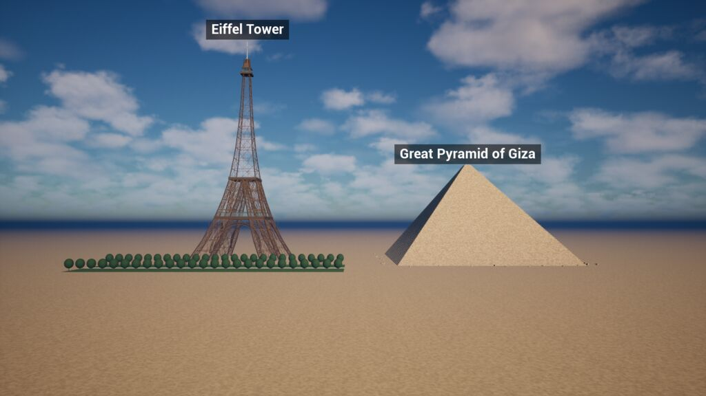
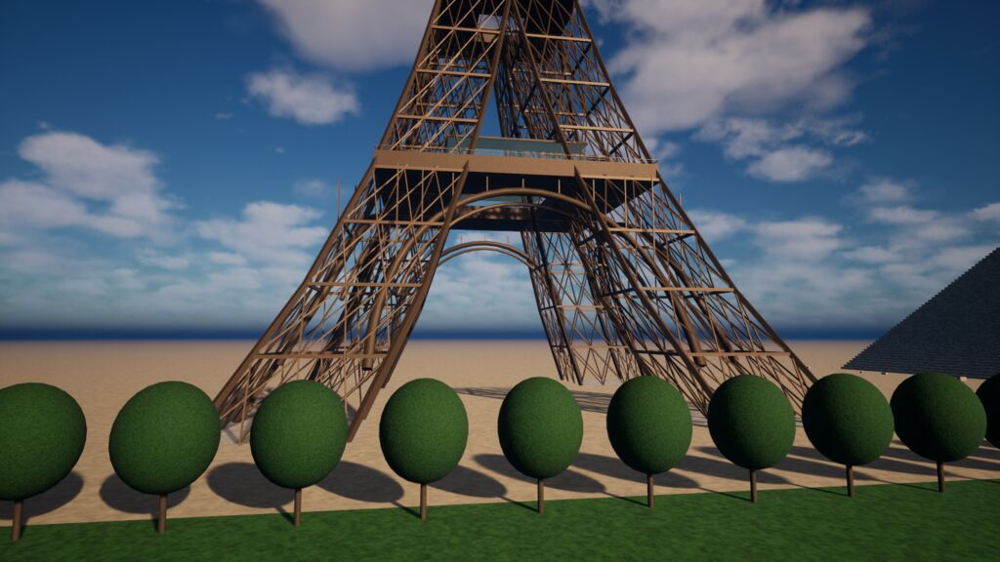
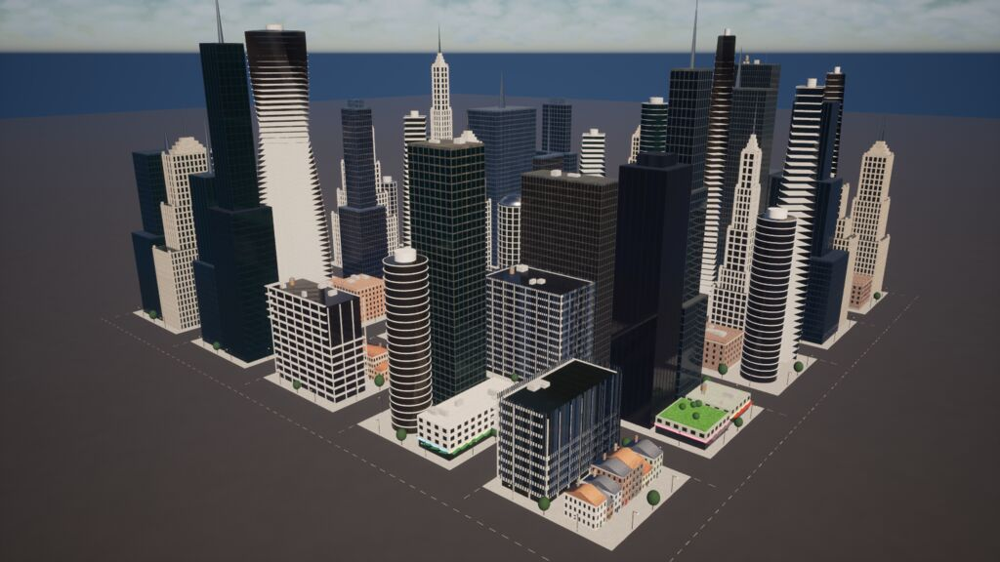
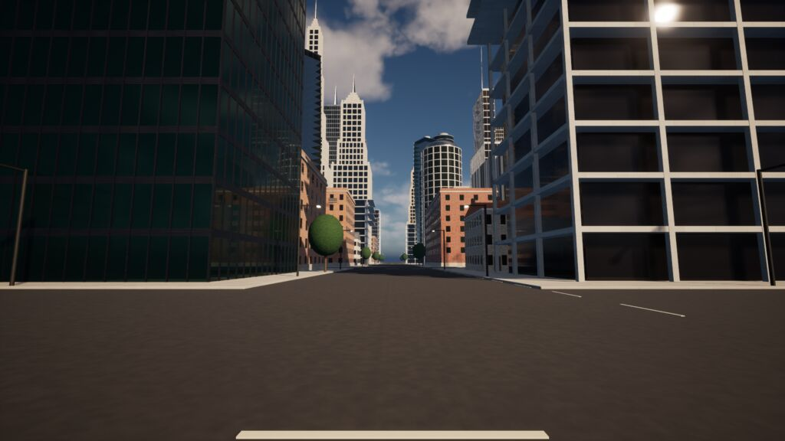
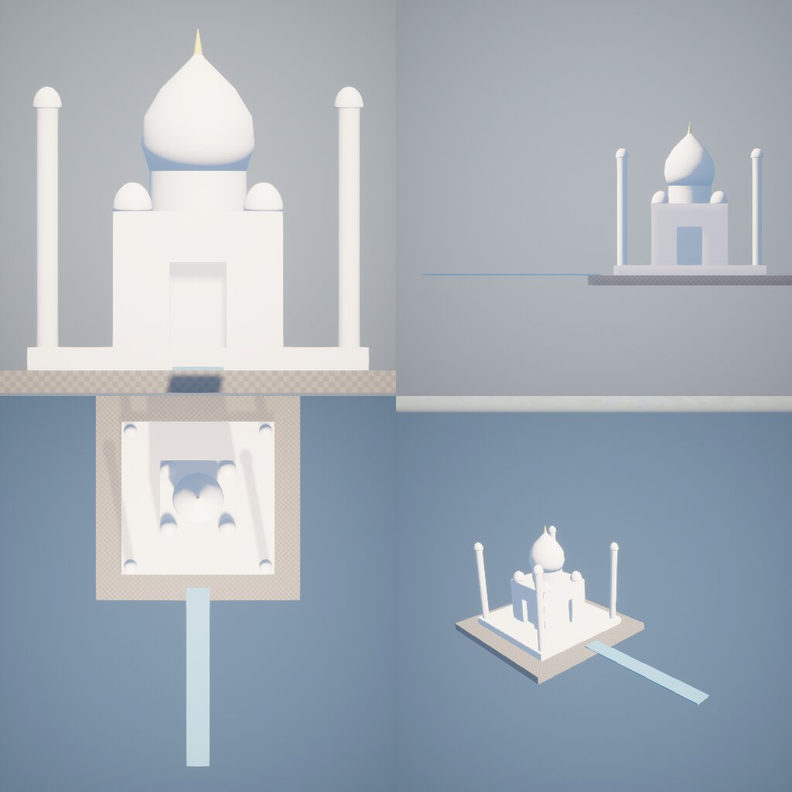
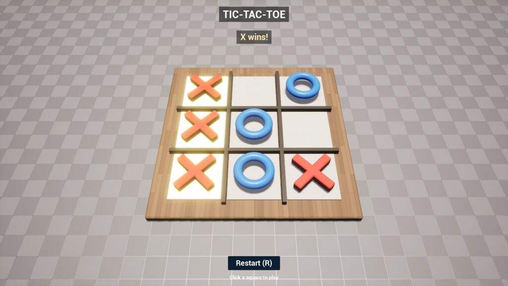
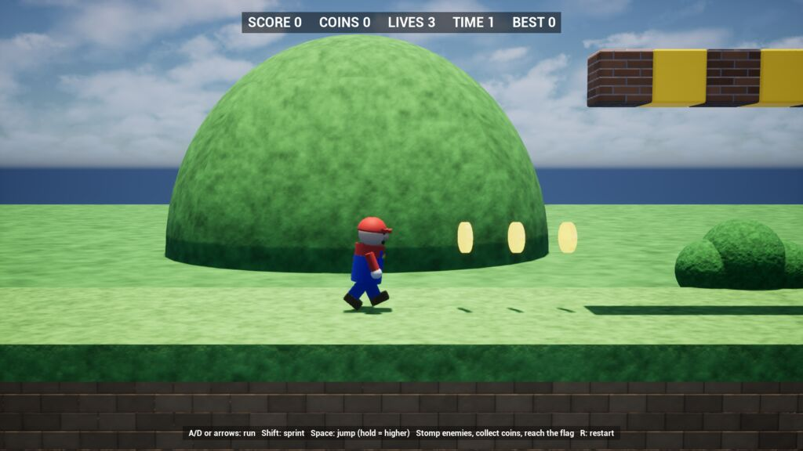

# RuntimeToolsets

Runtime-safe toolsets that let AI agents inspect and build inside a running Unreal Engine 5.8 game, including a packaged Development build. Epic's 5.8 MCP toolsets are editor-only; this plugin works without the editor.

The plugin only provides tools. A connector (yours, or the optional `RuntimeToolsetsMCP` adapter) owns transport, authentication and sessions.

## Toolsets

| Toolset | Tools |
|---|---|
| `session` | ping, get_build_info, get_capabilities, list_toolsets, describe_toolset, call_tool, get_usage_report, end_session |
| `actors` | spawn_actor, destroy_actor, find_actors, set_transform, attach, set_visibility, list_components |
| `scene` | create_group, list_tree, find_nodes, get_node, move_node, rotate_node, scale_node, reparent_node, set_pivot, rename_node, set_node_tags, duplicate_node, delete_node, clear_scope, clear_all, export_tree, import_tree |
| `reflection` | list_properties, get_property, set_property, call_function, list_functions, find_class, get_subsystem |
| `console` | exec_command, get_cvar, set_cvar, set_scalability, get_user_settings |
| `log` | tail_log, subscribe_log_category, get_stat |
| `capture` | screenshot (async), capture_render_target, scene_capture |
| `history` | undo, redo, get_history, begin_transaction, end_transaction, checkpoint, rollback, set_history_limit |
| `materials` | list_parameters, set_material, set_scalar, set_vector, set_texture, set_collection_param |
| `camera` | get_camera, set_camera, set_fov, frame_nodes, orbit, reset_camera, possess, set_view_mode |
| `build` | create_primitive, create_profile_solid, boolean_op, array, mirror, set_material, measure, check_overlaps, get_build_stats, capture_view |
| `layout` | align_nodes, distribute_nodes, snap_to_grid, drop_to_ground, arrange_in_row, arrange_in_grid, arrange_in_circle, randomize_transform, find_free_space |

| `ui` | list_widgets, list_widget_tree, find_widget, create_widget, create_hud_text, create_label, set_label, remove_widget, set_text, set_widget_visibility, set_brush, click_button |
| `vfx` | spawn_system, list_user_parameters, set_user_variable, activate, deactivate, list_active |
| `lighting` | get_environment, set_sun, set_sky, set_fog, set_post_process, set_time_of_day, apply_mood |
| `profiling` | frame_timing, find_hitches, memory_report, gpu_stats, start_trace, stop_trace |
| `ops` | run_batch, wait_for_condition, wait, list_tests, run_automation_test, get_test_status |
| `game` | get_game_state, list_players, teleport, set_pause, set_time_dilation |
| `physics` | line_trace, overlap_test, get_physics, set_simulate, add_impulse, ragdoll |
| `level` | list_levels, load_level_instance, unload_level, set_level_visibility, set_data_layer, open_level |
| `input` | inject_key, inject_action, add_mapping_context, remove_mapping_context |

`game`, `physics`, `level` and `input` live in `RuntimeToolsetsGameplay` (needs the EnhancedInput plugin). `load_level_instance` waits asynchronously until the level is visible (or pass `blocking:true`). `open_level` needs `confirm:true` because it destroys the world and all undo history. `inject_key` reports `handled:false` when nothing in the game consumed the key.

## Primitive builder (`build`)

Builder nodes are dynamic meshes (Geometry Script) generated from a JSON **recipe** that is stored as the node source (`prim:{...}`).

- **Assemblies (`create_assembly`):** up to 512 parts in one call, merged into one object with a material slot per distinct look and one undo step. Each part is a shape recipe plus location/rotation/scale and its own material. Where later parts lie flat against earlier ones facing the same way, they are nudged 3 mm outward, so touching parts don't flicker.
- **Shapes:**
  - basic: box, sphere, cylinder, cone, pyramid, torus, wedge, capsule, plane, dome, tube, arch, roof;
  - generators: lattice, tiers, steps, column, openings;
  - freeform: `revolve` (profile spun around Z), `loft` (rings with equal point counts skinned together), `extrude` (2D footprint pushed up, or a 3D outline pushed along a direction), `sweep` (profile along a 3D path), `raw` (triangles).
- **Sizes** are true scale in cm, and the pivot sits at the base by default.
- **Booleans** append to the target's recipe, so every mesh can be rebuilt. That keeps undo, `scene.duplicate_node`, `export_tree`/`import_tree` and arrays exact.
- **Materials:** physically based presets with a **procedural surface** projected in world space, so no UVs are needed:
  - patterns: brick bond and mortar, stone blocks, marble veins, roof-tile rows, planks, concrete panels, brushed metal, ground;
  - each has colour variation and a bump relief derived from the pattern;
  - per part you can override `color` (linear), `roughness`, `metallic`, `style`, `tile` (pattern size, cm) and `relief` (bump depth, cm). `bevel` chamfers edges.
  - The material is generated by `Scripts/create_materials.py`.
- **Generator scripts:** `Scripts/rtbuild.py` is a small Python library of part helpers (beam, loft, ring, revolve, onion, sweep, panel, arch outline, polar…) plus a client that sends parts in batches of 500. `Scripts/examples/eiffel_and_pyramid.py` builds the Eiffel Tower and the Great Pyramid at true scale, 2,000 parts, in 1.4 s:




- **City example:** `Scripts/examples/city.py --seed N` builds a district where no two buildings are alike: 8 building types (glass towers with setbacks, twisted towers, round towers, art deco, brick apartments, concrete-frame offices, townhouse rows, shop podiums), each with random size, floors, materials, window rhythm, crown and rooftop details, plus streets, sidewalks, lights and trees. 64 buildings, 12,700 parts, 7 s. A different seed gives a different city.




- **Guide:** `build.get_guide` tells prompted agents how to work at this quality level: real dimensions, generator scripts, materials, lighting and checking their own result.
- **Checking the work:** `capture_view` returns one contact sheet of ortho front/right/top and a perspective view, framing the whole build, so an agent can compare it with a reference. `check_overlaps` and `get_build_stats` report bounding-box overlaps and size/triangle counts.
- **Older demo:** `Scripts/build_landmark_demo.py` builds a simplified Taj Mahal with single primitives:



Any module can register how its node sources are rebuilt with `IRuntimeToolsetsCore::RegisterSourceSpawner`. Built-ins: `group`, `shape:`, `class:`, `prim:`, `vfx:`.

`profiling` and `ops` live in `RuntimeToolsetsOps`.
- **`ops.run_batch`** runs up to 100 calls in one request. With `atomic:true` it is all-or-nothing: it rolls back on the first failure, and one undo reverts a successful batch.
- **`ops.wait_for_condition`** polls any tool until a field of its result matches, e.g. `{"tool":"scene.get_node","arguments":{"target":"n5"},"path":"location[2]","op":"lt","value":60}`.
- **`ops.run_automation_test`** starts tests in the running game. Poll `ops.get_test_status` for results.
- **`profiling.start_trace`** writes Unreal Insights traces to the `Saved/Profiling` folder and never overwrites existing files.

`ui`, `vfx` and `lighting` are also in `RuntimeToolsetsPresentation` (needs UMG and the Niagara plugin). Widgets are addressed as `widget:Name` or by the path `ui.find_widget` returns; `create_hud_text` needs no widget asset. `create_label` puts a screen-facing name tag above a node and follows it (source `label:`). VFX nodes duplicate/export as `vfx:<system>` (user parameter overrides are not carried over). `apply_mood` changes sun angle/temperature, fog and global grading in one undo step; it leaves light intensities alone.

`materials` and `camera` live in the `RuntimeToolsetsPresentation` module; `layout` lives in `RuntimeToolsetsContent`. Debug view modes (unlit, wireframe…) are only available in cooked builds cooked with `r.ForceDebugViewModes=1`; otherwise `set_view_mode` returns `unsupported` and only `lit` works.

Each toolset's exact names and schemas are in `Tests/Schemas/<toolset>.json`, which is guarded by a snapshot test.

## Game logic (`logic`)

Turns a scene into a playable game with no code. The game runs inside the engine on its own; the agent only defines it.
`RuntimeToolsetsLogic` module, `logic.get_guide` explains it to agents.

- **Variables** (`define_vars`): numbers, text, lists, maps. `start` and the `restart` action reset them to their starting values.
- **Rules** (`define_rules`): *when* an event happens, *if* a condition holds, *run* actions.
  - Events: `start`, `click` and `right_click` (on a node, its children, or `tag:x`), `key`, `button`, `timer`, `var_changed`, custom `event`, `tick`.
  - Actions: `set`, `set_item`, `push`, `let`, `if`/`then`/`else`, `for`, `call` (any tool, with `=expr` and `{expr}` templated arguments), `emit`, `timer`, `cancel_timer`, `set_ui`, `log`, `restart`, `stop`.
  - Objects that rules create are removed on restart.
- **Expressions:** arithmetic, comparison and logic, `a ? b : c`, lists, maps and `event.*`, plus functions including the board-game helpers `grid_lines`, `line_winner`, `winning_line` and `winning_move`.
- **UI** (`define_ui`): on-screen text with live templates (`"{turn} to move"`) and buttons that fire `button` rules.
- **Input:** `set_input_mode cursor` shows the cursor, so clicks hit objects; `lock_camera` gives a fixed board view.
- **Testing and debugging:** `fire_event` simulates clicks, keys and buttons; `step` advances timers; `get_state` returns variables, timers and an event log with errors. Bad rules are rejected with the exact field and reason.
- **Undo and portability:** definitions are undoable, and `export`/`import` move a whole game as JSON.
- **Example:** `Scripts/examples/tictactoe.py [--ai]` is a full tic-tac-toe made only from tool calls: two players or against the computer, a win highlight, a draw, scores, a Restart button and R to restart. The tests build and play a whole win, draw and restart through the tools.



**Platformers** (`spawn_player`, `set_motion`, `set_solid`, `touch`/`fall` events):
- **The hero:** a playable side-scrolling character with a follow camera. A/D or arrows to run, Shift to sprint, Space to jump (hold for higher), and gamepad support. The default hero has a walk cycle, a jump pose, squash and stretch, and blinks while invulnerable after a hit.
- **Touch events** say how the player hit something: from above (stomp), from below (head bump) or from the side.
- **Moving objects:** patrol, path, bob, spin and waddle.
- **Actions:** `hide`/`show` (restored on restart), and `player` respawn/bounce/checkpoint/freeze/launch.

**Tweens** (`logic.tween` tool and `tween` action):
- Move, rotate, scale and colour.
- 16 easing curves; once, yoyo, loop or pingpong; delay and repeat.
- At the end: hide, show or release, and/or emit an event.

**Actor pools** (`define_pool`, with `spawn`/`release` actions): pre-made hidden copies, recycled instead of created. Used for coins popping out of blocks and stomp effects.

**Example:** `Scripts/examples/platformer.py` is a one-level platformer built only from tool calls:
- ground with pits, brick and question blocks, pipes, a moving platform, spikes, stairs and a castle;
- spinning coins, waddling enemies to stomp, a checkpoint and a flagpole;
- lives, score, time, best score, and Game Over / Course Clear screens with restart.



## Using it from C++ (connector API)

```cpp
#include "RuntimeToolsetsCore.h"

IRuntimeToolsetsCore& Core = IRuntimeToolsetsCore::Get();
FString Catalogue = Core.ListToolsets();                 // compact JSON
FString Actors    = Core.DescribeToolset(TEXT("actors")); // tools + input schemas

FToolCallerContext Caller;
Caller.SessionId = TEXT("user-42");                      // own undo history per session
Core.Invoke(TEXT("actors.spawn_actor"), TEXT(R"({"shape":"cube","location":[0,0,100]})"), Caller,
    FOnToolComplete::CreateLambda([](const FToolResult& R) { /* R.ToJsonString(), R.Attachments */ }));
```

- `Invoke` can be called from any thread. Calls run on the game thread one at a time, in order. Callbacks fire on the game thread.
- Arguments and results are plain JSON. Results look like `{"ok":true,...delta}` or `{"ok":false,"error":{"code","message","hint"}}`.
- Images (`capture.*`) are returned in `FToolResult::Attachments`.
- `OnEvent()` pushes log-subscription lines to connectors.
- Tool names are `toolset.tool`; `toolset_tool` is also accepted.

## Target syntax

Tools that act on something take a `target`:
- **Scene nodes:** `n12` (node id), `house/door` (node path).
- **Actors:** `actor:PointLight_0` (actor name).
- **Objects:** a full path such as `/Game/Map.Map:PersistentLevel.X`.
- **Static functions:** `class:/Script/Engine.KismetSystemLibrary` (the class default object).
- **Subsystems:** `subsystem:world/MySubsystem`.
- **Shortcuts:** `pawn`, `player_controller`, `game_mode`, `game_state`, `world_settings`, `game_user_settings`.
- **Components:** append `#ComponentName` to any of the above.

## Rules

- Mutating tools are undoable by default and history is kept per session. Irreversible tools (`exec_command`, non-pure `call_function`) are marked `undoable:false`; undo skips them and reports them.
- Deletes are soft (hidden, collision off). The actor is destroyed only when the entry leaves history.
- `clear_scope` and `clear_all` need `confirm:true`, create a checkpoint first, and only touch the caller's nodes.
- Policies are in **Project Settings → Plugins → Runtime Toolsets** (`DefaultGame.ini`):
  - Reflection allow-roots and deny-lists.
  - Spawn class roots.
  - Console deny prefixes, plus an optional allow-list.
  - Limits.
- Development builds only. The modules are denied in Shipping and Test.

## Packaging

- Always cook `/Engine/BasicShapes` (shapes and BasicShapeMaterial).
- Reflection only reaches classes and assets that were cooked.

## Tests

- **Editor:** `UnrealEditor-Cmd MCPProject.uproject -ExecCmds="Automation RunTests RuntimeToolsets,Quit" -unattended -nullrhi -TestExit="Automation Test Queue Empty"`
- **Packaged game:** `MCPProject.exe -ExecCmds="RuntimeToolsets.RunTests RuntimeToolsets. quit"`. The log ends with `RuntimeToolsets tests: N passed, M failed`.
- **Update schema snapshots** after an intentional API change: add `RuntimeToolsets.UpdateSchemaSnapshots 1` before `Automation RunTests`. Then review the diff and bump the toolset version.

See `Docs/ARCHITECTURE.md`, `Docs/AUTHORING.md` and `Docs/ERRORS.md`.
