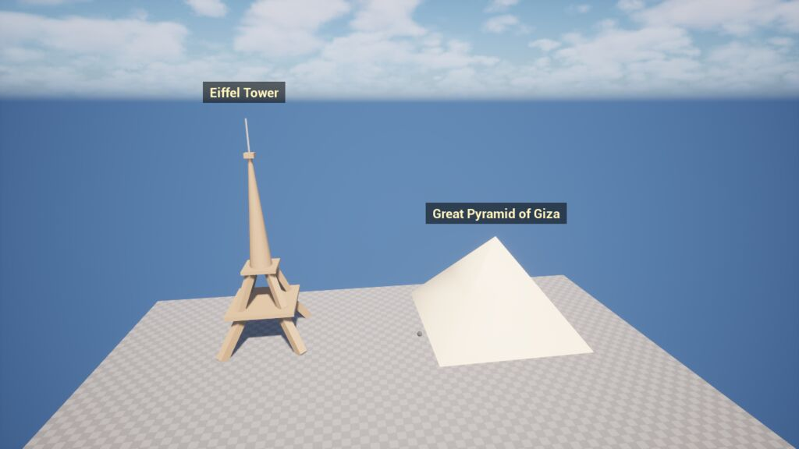

# MCPProject

A UE 5.8 host project for **RuntimeToolsets**, runtime MCP toolsets that work in a packaged game.

- `Plugins/RuntimeToolsets/`: the toolset plugin (core API, 8 toolsets, tests). Start with its `README.md`.
- `Plugins/RuntimeToolsetsMCP/`: an optional adapter that serves the tools over Epic's MCP HTTP server (`127.0.0.1:8018/mcp`).
- `Content/Maps/Sandbox.umap`: a test map (a copy of the engine Basic template).
- `Scripts/mcp_smoke_test.py`: an end-to-end MCP client test.

## Build and run

```powershell
# Editor
I:\ProgramFiles\UE_5.8\Engine\Build\BatchFiles\Build.bat MCPProjectEditor Win64 Development -Project="H:\aiworks\MCP\MCPProject\MCPProject.uproject"

# Packaged Development build -> Build\Packaged\Windows
I:\ProgramFiles\UE_5.8\Engine\Build\BatchFiles\RunUAT.bat BuildCookRun -project="H:\aiworks\MCP\MCPProject\MCPProject.uproject" -platform=Win64 -clientconfig=Development -build -cook -stage -pak -archive -archivedirectory="H:\aiworks\MCP\MCPProject\Build\Packaged"
```

## Connect an agent

1. Start the game (or PIE in the editor). The log prints `MCP server: http://127.0.0.1:8018/mcp`.
2. Register the server with Claude Code: `claude mcp add --transport http unreal-runtime http://127.0.0.1:8018/mcp`
3. Optionally, run the smoke test: `python Scripts/mcp_smoke_test.py --save-image shot.jpg`

The default exposure is `Meta`: only the `session_*` tools are listed. Agents call `session_list_toolsets`, then `session_describe_toolset`, then `session_call_tool`. To list every tool directly, set `ExposureMode=Eager` under `[/Script/RuntimeToolsetsMCP.RuntimeToolsetsMCPSettings]`.

## Drive it from a prompt

You don't call tools by hand: an agent does. With the game running:

```powershell
claude mcp add --transport http unreal-runtime http://127.0.0.1:8018/mcp   # once
claude    # then ask, e.g. "build the Eiffel Tower and the Great Pyramid side by side and label each with its name"
```

You can also run it in one shot: `powershell -File Scripts/prompt_demo.ps1 "your request"`.

From that exact prompt, a fresh Claude Code session discovered the tools, built both buildings, labelled them, framed the camera and checked its own screenshot, in 90 seconds and 19 undoable steps:



## Run the tests

```powershell
# Editor (headless)
UnrealEditor-Cmd.exe MCPProject.uproject -ExecCmds="Automation RunTests RuntimeToolsets,Quit" -unattended -nullrhi -TestExit="Automation Test Queue Empty"

# Packaged game
Build\Packaged\Windows\MCPProject.exe -ExecCmds="RuntimeToolsets.RunTests RuntimeToolsets. quit" -log
```
